<div align="center">

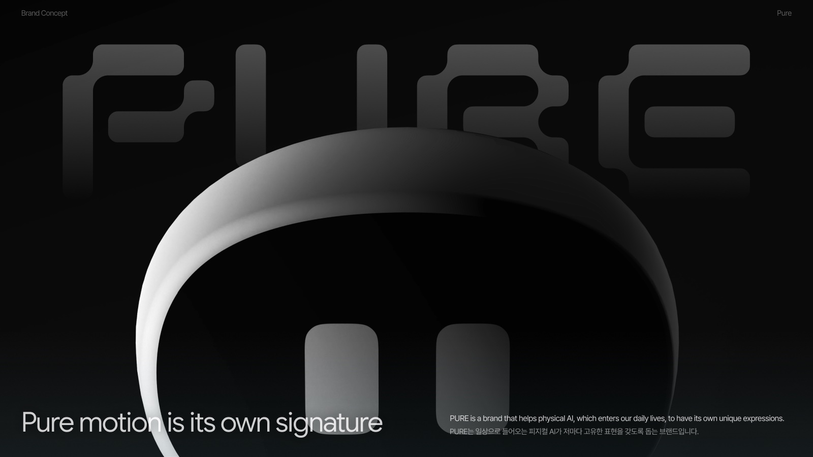

<br/><br/>

# PURE <sub>Expert Lab</sub>

### 일상으로 들어오는 로봇에게, 저마다의 모션체를

**PURE는 로봇에게 순수한 행동과 개성을 담은 ‘모션체(Motion Signature)’를 만들어주는 피지컬 AI 시뮬레이션 서비스예요.**

브랜드 가이드와 영상·이미지·문장을 넣으면 AI가 로봇의 **Motion · Face · Sound**를 만들고,<br/>
브라우저 안의 물리 시뮬레이터에서 바로 재생하며 다듬을 수 있어요.

<br/>

[](https://pure-web-omega.vercel.app)
[](https://nextjs.org)
[](https://react.dev)
[](https://www.typescriptlang.org)
[](https://tailwindcss.com)
[](https://r3f.docs.pmnd.rs)
[](https://mujoco.org)
[](https://ollama.com)
[](https://vitest.dev)


<sub>Team PURE · 최성근 Seonggeun Choi · 방태림 Taerim Bang · 전승아 SeungA Jeon</sub>

</div>

> **데모 안내** — Vercel 배포본에는 로컬 LLM(Ollama)이 없어서 생성은 **데모 레시피**로 동작해요. 데이터는 서버 임시 폴더에 저장돼 언제든 처음 시드 상태로 돌아갈 수 있어요. 전체 기능은 [로컬 실행](#-시작하기)으로 확인할 수 있어요.

---

<div align="center">

> ### “사람마다 개성이 드러나는 글씨체가 있듯, 이제 로봇에게도 모션체가 있어요.”
> 목적이나 효율에서 잠깐 벗어나 **자기 존재의 성격이 드러나는 순수한 움직임**, 우리는 그걸 **PURE**라고 불러요.

</div>

---

## 📑 목차

[**기획**](#-기획--왜-pure인가) · [**모션 시그니처**](#-모션-시그니처) · [**Core Value**](#-core-value) · [**시나리오**](#-시나리오) · [**주요 기능**](#-주요-기능) · [**가이드라인 체계**](#-pure-motion-guideline) · [**아키텍처**](#-아키텍처) · [**기술 스택**](#-기술-스택) · [**설계 결정**](#-설계-결정) · [**시작하기**](#-시작하기) · [**출처**](#-출처--오픈소스) · [**팀**](#-팀)

---

## 🎯 기획 — 왜 PURE인가

2026년, 로봇은 작고 친근한 모습으로 일상에 들어오기 시작했어요. 2030년에는 누구나 집에서 로봇을 만나게 될지도 몰라요.


그런데 모든 로봇이 똑같이 말하고, 똑같이 움직이고, 똑같이 표현한다면 — 거기서 개성을 느낄 수 있을까요?

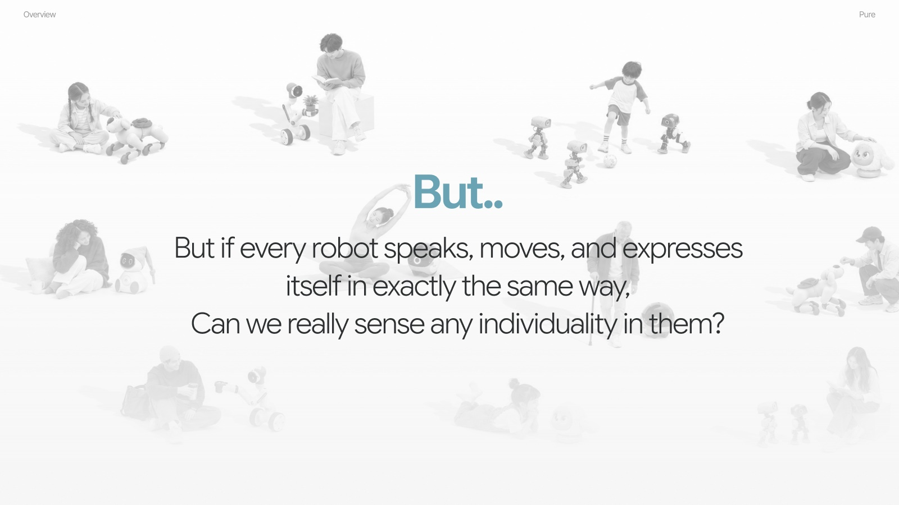

### 기능 너머의 움직임에서 개성을 찾았어요

정확한 실행이라는 기능적인 움직임 말고도, 꾸벅꾸벅 졸고, 꼼지락거리고, 분위기를 읽는 움직임이 있어요. 반가워서 헥헥거리는 숨, 좋아서 나도 모르게 흔들리는 꼬리처럼요.

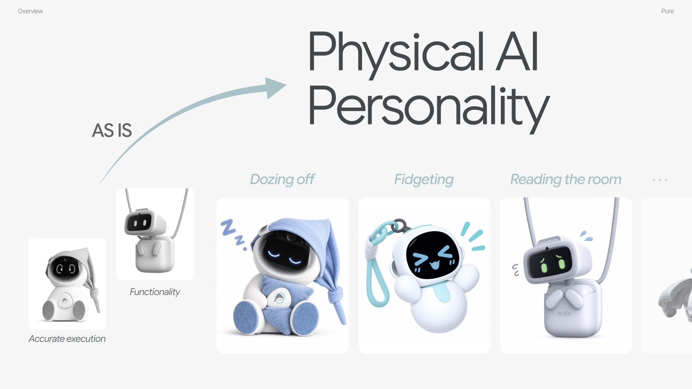

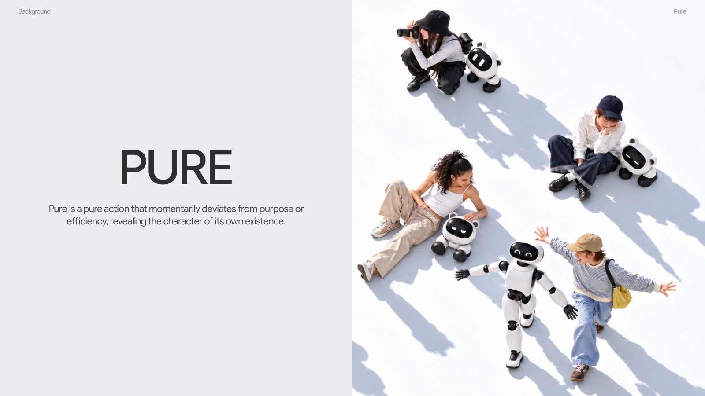

### 시장은 커지는데, 표현은 설계자가 정한 만큼만

피지컬 AI 시장은 2020년 50억 달러에서 2030년 6,430억 달러로 커질 것으로 전망돼요(Statista). 로봇 학습과 움직임 설계에는 시뮬레이션이 이미 일반적이고, 표현적인 움직임을 담으려는 연구도 이어지고 있어요.

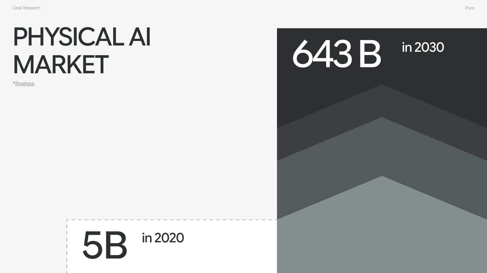

| | 지금 (As Is) | PURE (To Be) |
|---|---|---|
| **표현의 출처** | 설계자가 미리 정해 둔 감정과 행동만 표현 | 사용자와 기업이 고른 레퍼런스에서 표현을 만듦 |
| **개성** | 같은 제품이면 모두 같은 움직임 | 브랜드·사용자마다 다른 모션체 |
| **적용 범위** | 특정 로봇 하나를 위한 모션 | 여러 형태의 로봇에 같은 규칙으로 적용 |

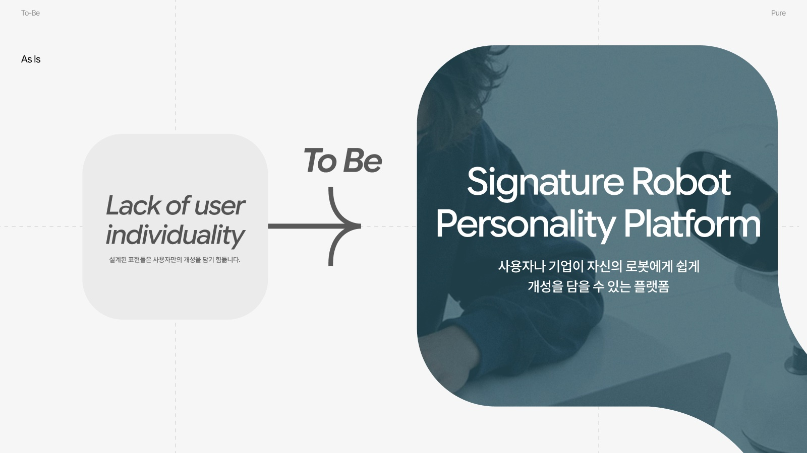

---

## ✍️ 모션 시그니처


다양한 개성을 모으고, 시뮬레이션으로 익혀서, 내 로봇만의 모션체로 만들어요. 사람의 개성이 **글씨체**에 드러나듯, 로봇의 개성은 **모션체**에 드러나요.


| | |
|---|---|
| **Who** | 피지컬 AI 디자이너 · 개발자, 그리고 미래의 사용자 |
| **What** | 로봇의 상태를 움직임으로 바꿔 주는 생성형 가이드라인과 웹 시뮬레이터 |
| **Why** | 기능을 넘어선 순수한 움직임으로 친근하게 소통하도록 |
| **When · Where** | 초기 콘셉트 설계와 사용자 반응 기반 모션 제작, 사람과 같은 공간에서 상호작용하는 로봇 |
| **How** | 규칙 기반 가이드라인 + 로컬 LLM으로 모션 생성, 물리 시뮬레이터로 검증 |
| **Device** | 시뮬레이터 웹 · 가이드라인 북 · 예시 프로덕트 |

### 파이프라인

맥락 입력(텍스트 · 이미지 · 영상) → 상태 분석 → PURE 디자인 시스템 → 출력(Motion · Face · Sound) → 로봇에 적용, 그리고 사용자 반응이 다시 입력으로 돌아와요.

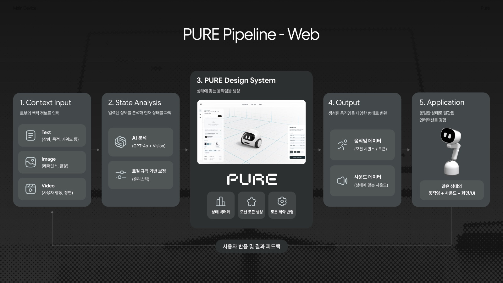

---

## 💎 Core Value

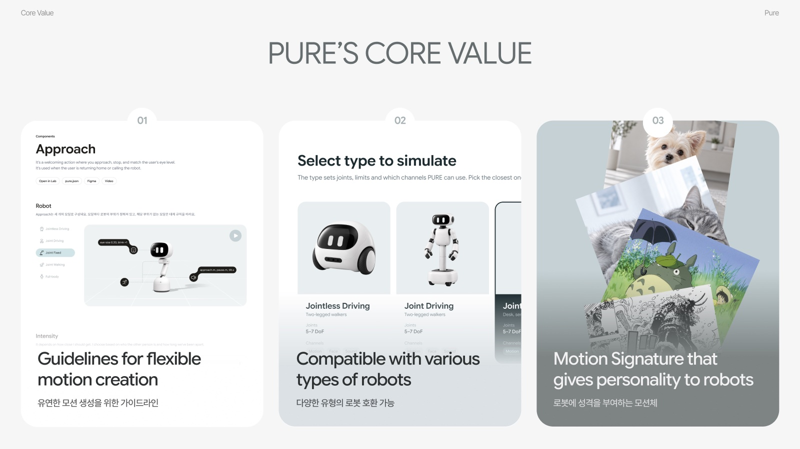

| | 가치 | 구현 |
|---|---|---|
| **01** | 유연한 모션 생성을 위한 **가이드라인** | 원칙 · 토큰 · 컴포넌트 · 패턴 · 템플릿으로 나뉜 디자인 시스템. 사람이 읽는 문서이자 AI가 읽는 데이터 |
| **02** | **다양한 유형의 로봇** 호환 | 규칙을 관절 이름이 아니라 역할(시선 · 자세 · 이동 · 가리킴)에 묶어, 폼팩터 5종에 같은 행동을 옮김 |
| **03** | 로봇에 성격을 부여하는 **모션체** | 브랜드 시그니처 축 + 스타일 강도로, 같은 행동도 브랜드마다 다르게 |

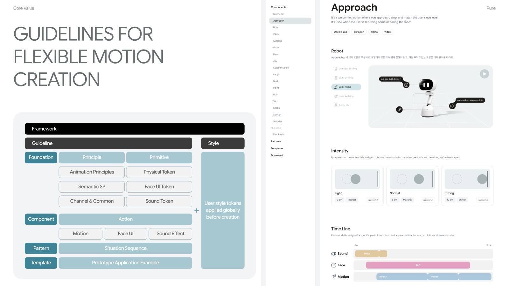

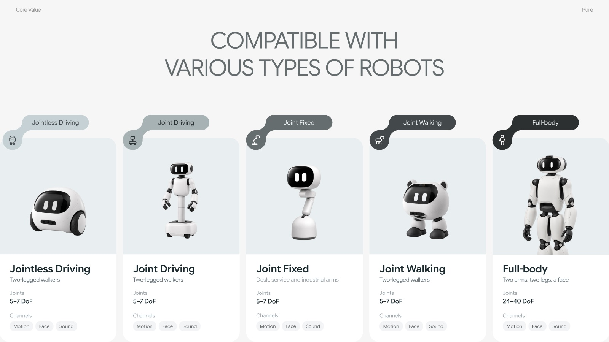

---

## 🎬 시나리오

### SCEN. 1 — 자사 로봇을 등록하고 브랜드 정체성 반영하기

여러 형태의 로봇과 호환되고, 자사 로봇 파일로 시뮬레이션을 시작할 수 있어요. 등록한 로봇에 브랜드 가이드를 넣으면 브랜드만의 모션 시그니처가 세팅돼요.

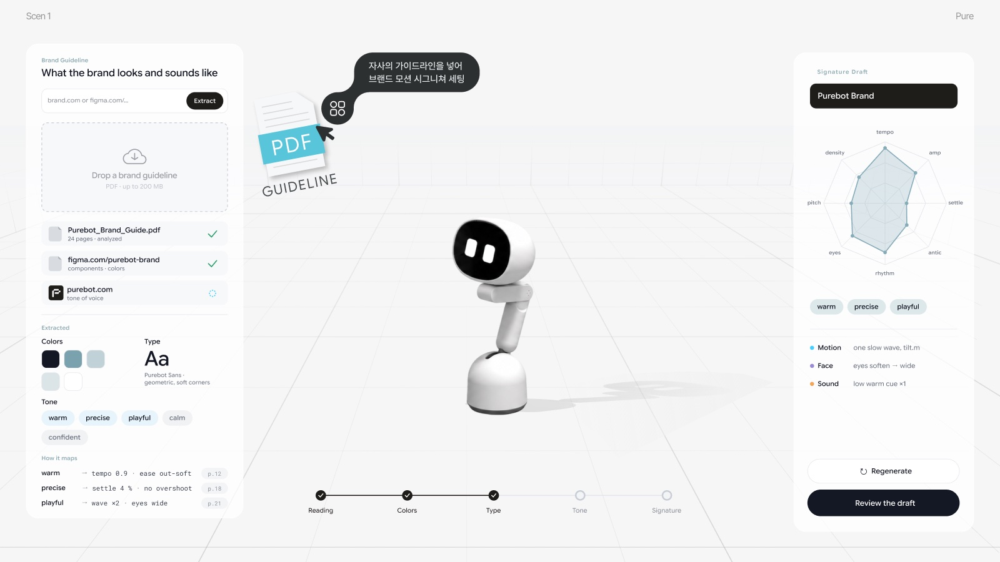

### SCEN. 2 — 등록한 로봇으로 시뮬레이션 테스트하기

영상 · 이미지 · 텍스트로 모션을 만들고, 만들어진 모션의 각 요소는 바로 가이드라인 페이지로 이어져요. 막막할 땐 커뮤니티에서 다른 사람이 만든 모션을 둘러볼 수 있어요.

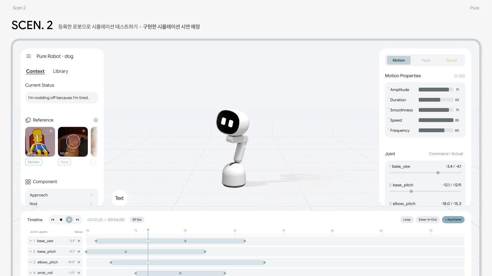

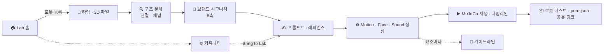

---

## ✨ 주요 기능

| | |
|---|---|
| 🤖 **로봇 등록 · 구조 분석** | 폼팩터 5종 중 고르거나 3D 파일을 올리면 메시 읽기 → 관절 찾기 → 관절 한계 → 채널 감지 4단계 분석. 잡(job)으로 돌아서 화면을 떠나도 계속돼요 |
| 🎨 **브랜드 시그니처** | 브랜드 가이드 PDF나 URL에서 색 · 서체 · 톤을 뽑아 8축(`Tempo` `Amplitude` `Settle` `Anticipation` `Rhythm` `Eyes` `Pitch` `Density`) 시그니처를 제안. 레이더를 드래그해 조정하고 버전을 비교 · 복원 |
| ⚙️ **표현 생성** | 상황 문장 + 이미지 · 영상 레퍼런스를 로컬 LLM이 읽고 Motion · Face · Sound를 JSON Schema로 생성. 비전 모델이 레퍼런스를 먼저 요약해요 |
| ▶️ **물리 시뮬레이션** | 브라우저 안의 MuJoCo(WebAssembly)로 PURE Desk(5축 탁상 로봇)가 바로 재생. 30fps 타임라인 키프레임 편집, 관절별 명령값 / 실제값 |
| 🙂 **Face · 🔊 Sound** | 얼굴 영상 7종(neutral · smile · sleepy · sad · surprise · tilt · heart), 녹음된 로봇 사운드 10종을 시그니처 Pitch 축으로 보정 |
| 🛡️ **검증과 폴백** | LLM 출력은 재생 전에 행동 허용 목록 · 범위 클램프 · 관절 한계 · 각속도 · 15초 길이 검사를 거쳐요. Ollama가 없거나 실패하면 데모 레시피로 대체 |
| 📦 **테스트 · 내보내기 · 공유** | 로봇 테스트(시연용 더미 로봇 · 관절 호환성 검사), `pure.json` 내보내기, 공유 링크(만료일 · 비밀번호 해시 · 5회 실패 잠금 · 다운로드 허용) |
| 📘 **가이드라인 사이트** | 원칙 · 토큰 · 컴포넌트 · 패턴 · 템플릿 · 스타일 · 검증을 문서 사이트로. 전역 검색(한 글자 오타 허용), `pure.tokens` JSON 다운로드 |
| 🌐 **커뮤니티 · 프로필** | 다른 팀의 모션을 재생해 보고 내 프로젝트로 가져오기(Bring to Lab). 컴포넌트 · 상황 패턴은 가이드라인 페이지로 연결 |

### 실제 화면

<div align="center">

| 랜딩 | 실험실 홈 |
|:---:|:---:|
|  |  |
| 로봇 타입과 가이드라인 소개 | 로봇 프로젝트 · 분석 진행률 |

| 구조 확인 | 브랜드 시그니처 |
|:---:|:---:|
|  |  |
| 관절 목록과 채널 | 8축 레이더 · 버전 비교 |

| 에디터 | 커뮤니티 |
|:---:|:---:|
|  |  |
| MuJoCo 재생 · Motion / Face / Sound | 공유된 모션 둘러보기 |

| 가이드라인 — Face 원칙 | 가이드라인 — Approach 컴포넌트 |
|:---:|:---:|
| 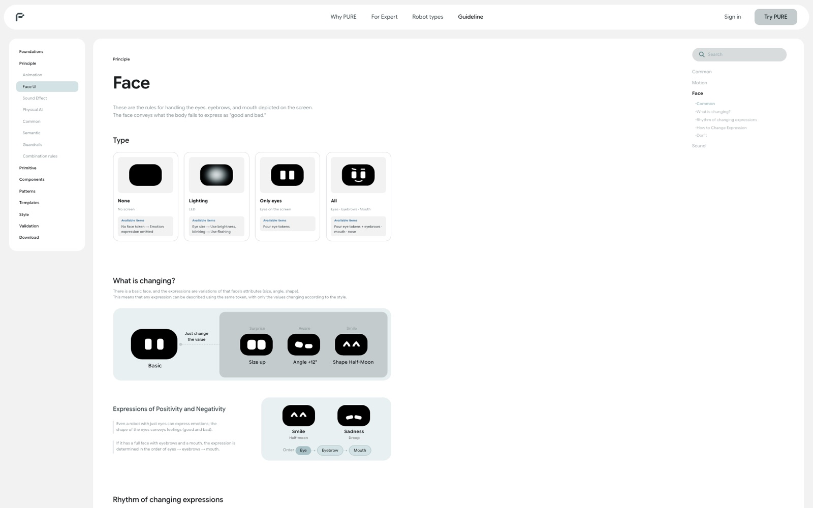 | 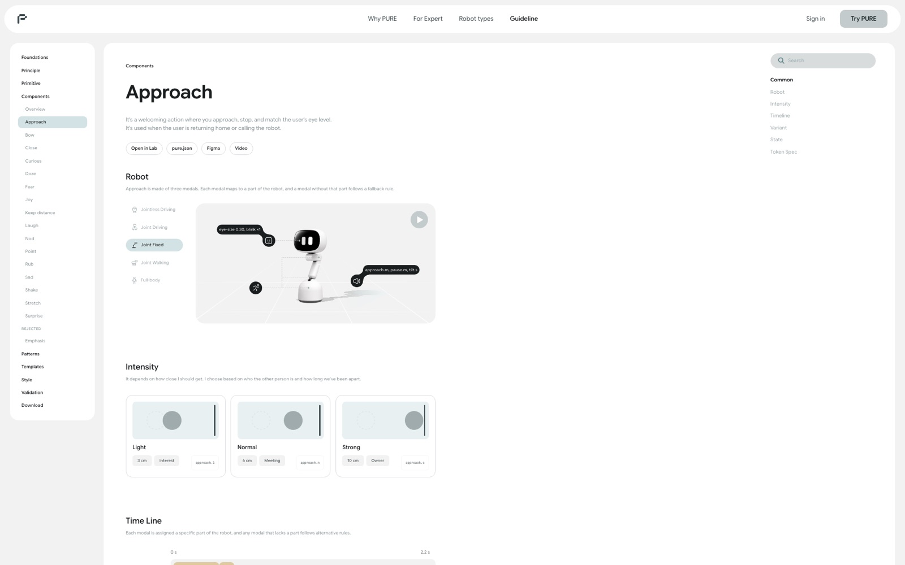 |
| 얼굴 클래스 · 표정 리듬 · Don't | Robot · Intensity · Time Line · Token Spec |

</div>

---

## 📘 PURE Motion Guideline

### 근거에서 출발한 원칙

피지컬 AI 모션 인식 본조사(n = 47)에서 17개 행동을 보여주고 전달률 · 확신도 · 고장 지각 · 호감을 측정했어요. "고장처럼 보이지 않는 게 먼저"(고장 지각 × 전체 평가 r = −0.80), "몸은 세기를, 얼굴과 소리는 좋고 나쁨을" 같은 의미 원칙과 MUST 가드레일이 여기서 나왔어요.

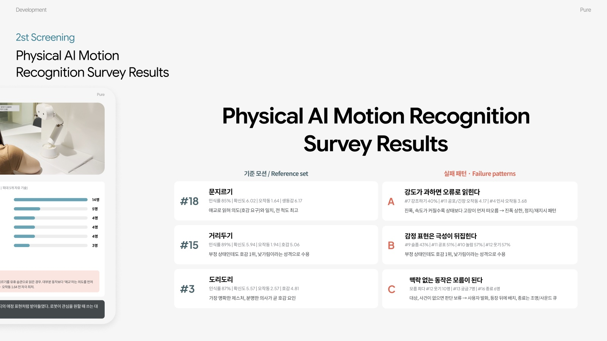

### 층 구조

가이드라인은 디자인 시스템의 층을 따라요. 아래 층만 참조하고(컴포넌트는 토큰 이름만, 패턴은 컴포넌트만), 스타일은 **값만** 바꿀 수 있어요.

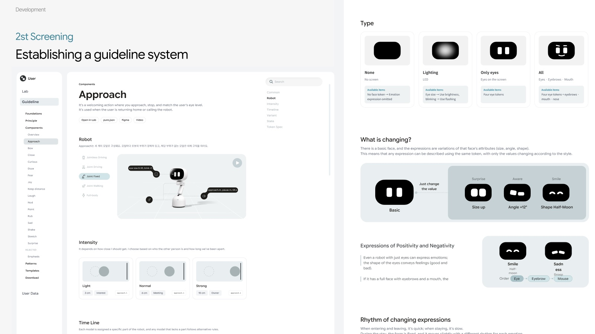

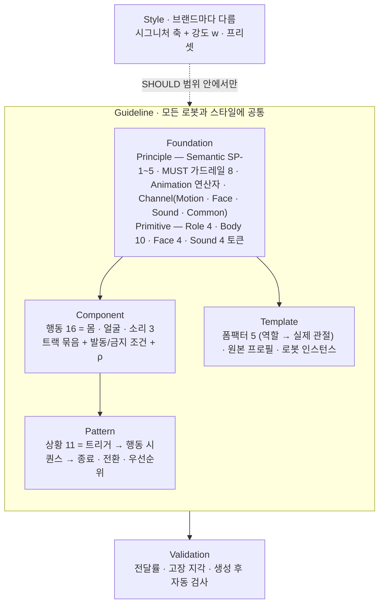

| 수준 | 뜻 | 누가 바꾸나 |
|---|---|---|
| **MUST** · 꼭 지켜요 | 어기면 고장 · 오해 · 위험으로 읽혀요 | 아무도 못 바꿔요 — 자동 보정 + 알림 |
| **SHOULD** · 기본값과 범위 | 권장값과 허용 범위 | 스타일은 범위 안에서만 |
| **MAY** · 자유 | 정체성 영역 | 원본 영상과 사용자 스타일 |

### 생성 계산식

스타일은 행동마다 다르게 스며들어요. 약속된 신호(도리도리)는 원형을 지키고, 정서 표현(기쁨)은 스타일을 강하게 받아요.

```
final = clamp( source + w × ρ × (style − source),  guardrails )

  source  원본에서 측정한 값        w  스타일 강도 (0–1)
  style   선택한 스타일 좌표        ρ  행동별 스타일 수용 계수
  clamp   MUST 가드레일 + 로봇 관절 · 속도 한계
```

### 브랜드 디자인 시스템

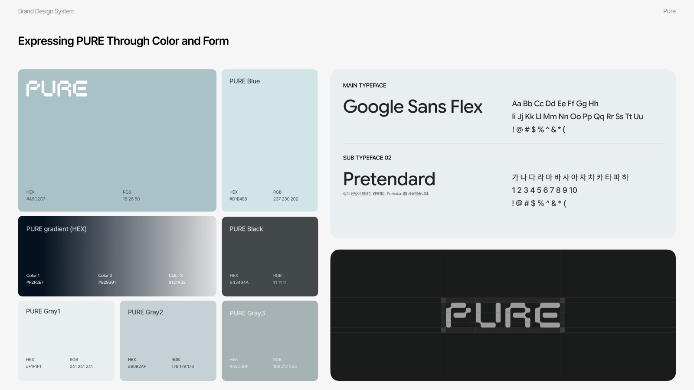

웹의 색 · 타이포 · 간격은 Figma Dev Mode 변수를 그대로 옮긴 토큰(CSS 변수)만 써요. 컴포넌트에 색을 직접 적지 않아요.

---

## 🏗️ 아키텍처

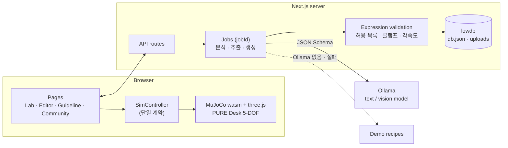

- **생성 경로** — 레퍼런스 이미지 · 영상 프레임은 비전 모델이 먼저 요약하고, 텍스트 모델이 시그니처 · 상황 · 레퍼런스를 받아 JSON Schema에 맞춘 레시피를 돌려줘요. 검증 계층을 통과한 것만 시뮬레이터로 가요.
- **잡** — 분석 · 추출 · 생성은 `jobId`가 붙은 작업이라, 화면을 떠났다 돌아와도 진행 상태가 복구돼요.
- **가이드라인 데이터** — 원칙 · 토큰 · 컴포넌트 · 패턴은 `data/guideline`의 타입이 있는 데이터 한 벌이고, 웹 페이지 · 검색 · 토큰 JSON · LLM 프롬프트가 모두 여기서 만들어져요.

---

## 🧰 기술 스택

| 영역 | 사용 기술 |
|---|---|
| 프레임워크 | **Next.js 15** (App Router) · **React 19** · **TypeScript** |
| 스타일 | **Tailwind CSS v4** · Figma Dev Mode 변수에서 옮긴 디자인 토큰(CSS 변수) |
| 3D · 시뮬레이션 | **MuJoCo (WebAssembly)** · three.js · React Three Fiber / drei |
| AI | **Ollama** 로컬 LLM (`/api/chat`, JSON Schema 출력, 이미지 입력) |
| 데이터 | lowdb(JSON) · zod 스키마 · pdf-parse · cheerio |
| 테스트 | Vitest |
| 배포 | Vercel (데모 모드) |

<details>
<summary><b>폴더 구조</b></summary>

```
app/
  (public)/       랜딩 · 공개 가이드라인
  (lab)/lab/      실험실 홈 · 로봇 등록 · 에디터 · 가이드라인 · 커뮤니티 · 프로필
  api/            프로젝트 · 잡 · 업로드 · 시그니처 · 표현 · 라이브러리 · 공유
  s/[shareId]/    공유 뷰어
  dev/            개발 계기판
components/
  ui/             디자인 시스템 컴포넌트 · 가이드라인 문서 템플릿
  sim/            MuJoCo 런타임 · Viewport · SimController (봉인)
lib/
  llm/            Ollama 클라이언트 · 프롬프트 · 데모 폴백
  expression/     검증 · 클램프 · 리타깃 · pure.json
  jobs/ robot/ signature/ reference/ sound/ ui/
data/             콘텐츠 (타입 · 컴포넌트 · 패턴 · 시드 · 가이드라인 · 문구)
public/           mujoco/ (wasm) · pure-desk/ (모델 · 얼굴 영상) · sounds/
docs/             PRD · decisions · checks · deck · readme
```

</details>

---

## 🧭 설계 결정

`docs/decisions.md`에 날짜별로 남긴 결정 중 일부예요.

| 결정 | 이유 |
|---|---|
| **시뮬레이터는 봉인 모듈** | MuJoCo 런타임(`lib/sim`, `components/sim`)은 이식 후 내부를 고치지 않고 `SimController` 하나만 노출해요. UI와 생성 로직이 바뀌어도 재생 엔진은 흔들리지 않아요 |
| **LLM 출력은 그대로 믿지 않기** | 행동 허용 목록 · 속도 · 진폭 · 반복 클램프 · 관절 한계 · 각속도 · 15초 제한을 거치고, 고친 항목은 하나하나 기록해요 |
| **시연 경로는 죽지 않기** | Ollama가 없거나 응답이 깨지면 항상 데모 레시피로 대체해요. 배포본도 같은 방식이에요 |
| **디자인 값은 Figma Dev Mode에서** | 색 · 타이포 · 간격은 Figma 변수를 토큰으로 옮겨 쓰고, 스크린샷은 구현 후 비교용으로만 써요 |
| **콘텐츠와 코드 분리** | 로봇 타입 · 컴포넌트 · 패턴 · 프리셋 · 시드 · 가이드라인 본문 · UI 문구는 모두 `data/`에 있어요 |
| **칩과 재생 행동 분리** | 에디터의 컴포넌트는 가이드라인의 행동 16개, 시뮬레이터가 재생하는 행동은 15개 — 매핑으로 잇고, 옛 데이터는 로드할 때 마이그레이션해요 |

---

## 🚀 시작하기

**요구 사항:** Node.js 22

```bash
git clone https://github.com/cherrymixy/pure-web.git
cd pure-web
npm install
npm run dev          # http://localhost:3000
```

실제 생성을 쓰려면 Ollama를 띄워요(없으면 데모 레시피로 동작해요).

```bash
ollama serve
ollama pull qwen3:8b          # OLLAMA_MODEL (기본값)
ollama pull gemma3:4b         # OLLAMA_VISION_MODEL (기본값)
```

```bash
npm test             # Vitest
npm run typecheck    # tsc --noEmit
scripts/demo.sh      # 전시 모드: Ollama 예열 · 프로덕션 빌드 · 전체 화면 Chrome
```

> 데스크톱 1920px 기준으로 만들었어요. 개발용 계기판 `/dev`에서 구현된 화면 목록, Ollama 상태, 시뮬레이터 · 토큰 · LLM 테스트 화면을 볼 수 있어요.

---

## 📎 출처 · 오픈소스

| 항목 | 출처 | 비고 |
|---|---|---|
| 물리 시뮬레이터 | [MuJoCo](https://github.com/google-deepmind/mujoco) (Google DeepMind) | `public/mujoco/`의 WebAssembly 빌드를 브라우저에서 실행 |
| 관절 · 채널 규칙 | [LeLamp](https://github.com/humancomputerlab/LeLamp) | 관절 이름(서보 id 1–5)과 채널 체계를 LeLamp 규칙에 맞춤. 3D 모델 · 메시 · 시뮬 코드는 PURE Desk용으로 따로 만듦 |
| 레퍼런스 이미지 · 영상 | Wikimedia Commons | 항목마다 저작자 · 라이선스(CC BY / BY-SA) · 원문 링크를 앱 화면에 표시 |
| 폰트 | Google Sans Flex · Google Sans Code · Roboto Mono | SIL Open Font License, `app/fonts/`에 라이선스 포함 |

---

## 👥 팀

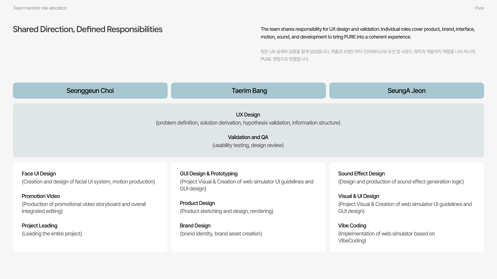

UX 설계와 검증은 셋이 함께 맡고, 제품 · 브랜드 · 인터페이스 · 모션 · 사운드 · 개발을 나눠 하나의 PURE 경험으로 이었어요.

| 이름 | 역할 |
|---|---|
| **최성근** Seonggeun Choi | Face UI Design · Promotion Video · Project Leading |
| **방태림** Taerim Bang | GUI Design & Prototyping · Product Design · Brand Design |
| **전승아** SeungA Jeon | Sound Effect Design · Visual & UI Design · Vibe Coding(웹 시뮬레이터 구현) |
| 공통 | UX Design · Validation and QA |

<div align="center">

<br/>

**PURE** · Purebot Co. · ✉️ hongik.pure@gmail.com<br/>
<sub>졸업전시 프로젝트 — 실제 서비스가 아닌 시연용 결과물이에요.</sub>

</div>
