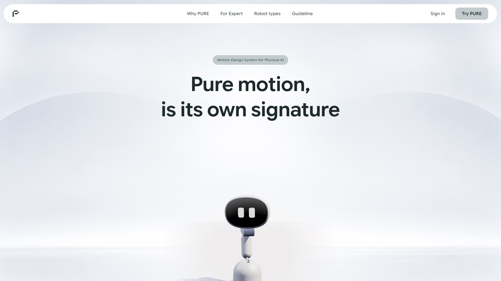
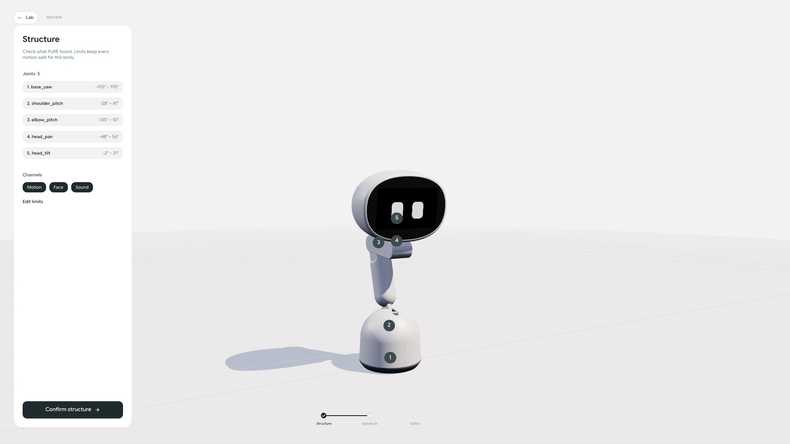
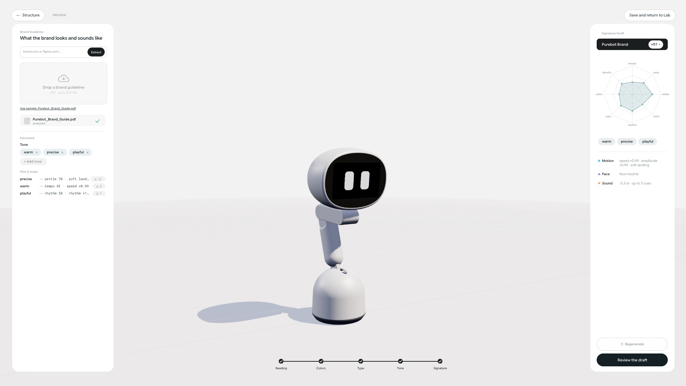
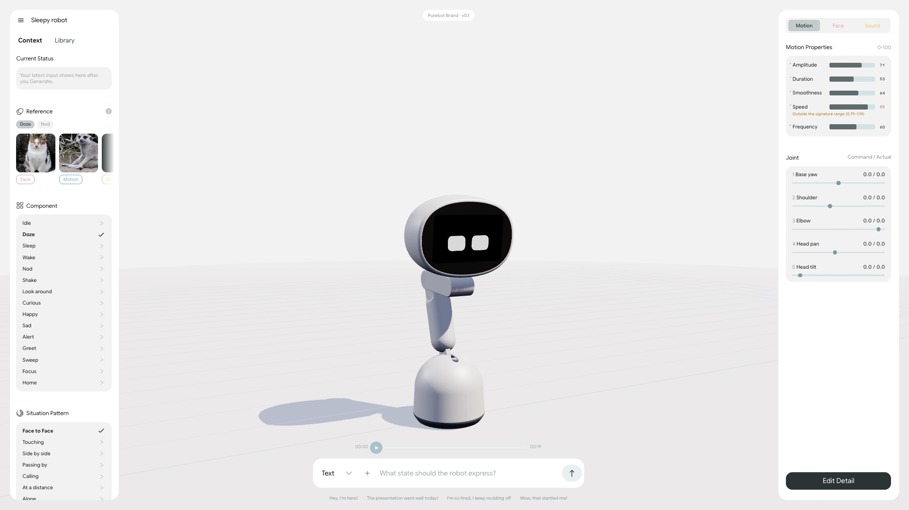
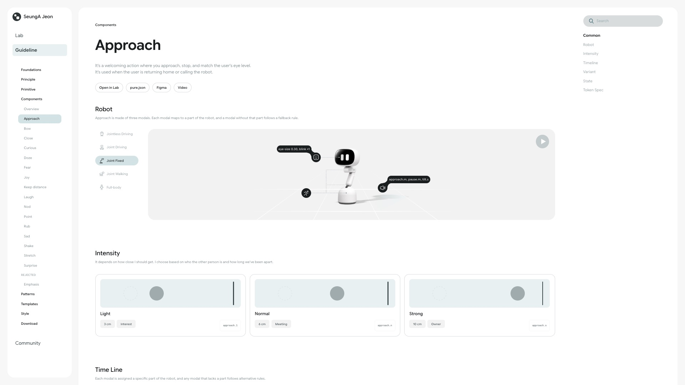
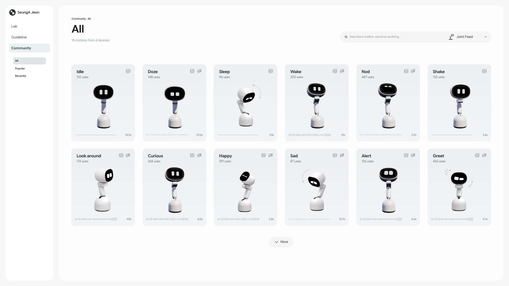
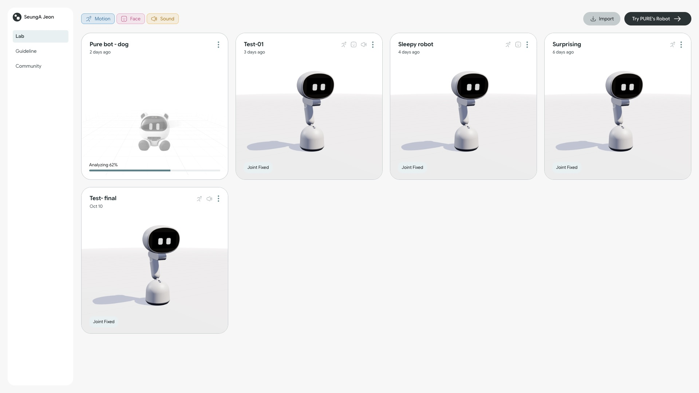

<div align="center">

# PURE — Expert Lab

**Pure motion, is its own signature.**
A motion design system for Physical AI: a robot's motion, face and sound are generated from the brand, then played and tuned in a physics sim.

[**▶ Live demo — pure-web-omega.vercel.app**](https://pure-web-omega.vercel.app)



</div>

---

## What it does

| | |
|---|---|
| **1. Robot type & structure** — Pick a robot type and check its joints and channels (motion · face · sound). |  |
| **2. Brand signature** — Upload a brand guide; it becomes an 8-axis signature (tempo, amplitude, settle, eyes, pitch…). |  |
| **3. Generate & tune** — Describe a situation; the LLM writes motion, face and sound, validated and played on the MuJoCo sim of PURE Desk. Edit on the timeline, test, export `pure.json`. |  |
| **4. Guideline** — Components and situation patterns of the PURE motion language. |  |
| **5. Community** — Motions shared by other teams, ready to bring into the lab. |  |



## Stack

- **Next.js 15** (App Router) · **React 19** · **TypeScript** · **Tailwind v4**
- **MuJoCo wasm** + **three.js** — 5-DOF PURE Desk robot simulated in the browser; the face is a set of video loops on its screen
- **Ollama** (local LLM, JSON-schema output) for generation — every output is validated (allow lists, range clamps, angular velocity); without Ollama the app falls back to demo recipes
- **lowdb** JSON store · zod schemas · Vitest

## Run locally

```bash
npm install
npm run dev            # http://localhost:3000
```

Optional, for live generation instead of demo recipes:

```bash
ollama serve
ollama pull qwen3:8b && ollama pull gemma3:4b   # OLLAMA_MODEL / OLLAMA_VISION_MODEL
```

Exhibition mode (Ollama warm-up, production build, full-screen Chrome): `scripts/demo.sh`.

```bash
npm test               # vitest
npm run typecheck
```

## About the live demo

- The Vercel build runs without Ollama, so **Generate uses the demo recipes**.
- Data lives in the server's temp folder: projects you create there are **not permanent** and can reset at any time. Every visitor starts from the same seed projects.
- Best viewed on a desktop at 1920 px wide.

## Project layout

```
app/          (public) landing · (lab) lab, editor, guideline, community · api/ · s/ share pages
components/   ui/ · sim/ (MuJoCo runtime, viewer, SimController contract)
lib/          models · repo · sim/ · llm/ · signature/ · expression/ · sound/
data/         content (types, behaviors, patterns, prompts, presets, seeds, guideline text)
public/       mujoco/ (wasm) · pure-desk/ (robot model, face videos)
docs/         PRD · decisions log · checks
```

---

<sub>Graduation exhibition project. Not a production service.</sub>
