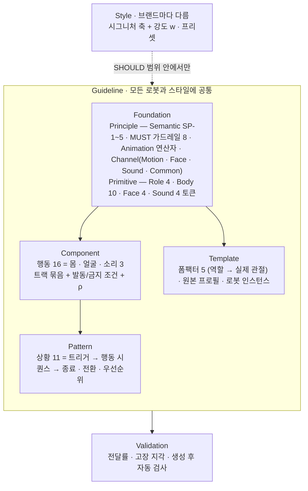
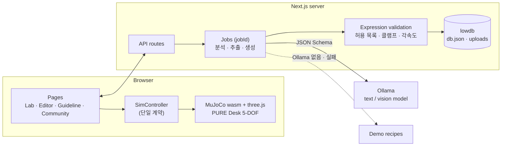

<div align="center">

# PURE — Expert Lab

**Pure motion, is its own signature.**

물리 AI 로봇을 위한 모션 디자인 시스템.<br>
브랜드에서 뽑은 시그니처와 가이드라인을 바탕으로 로봇의 **Motion · Face · Sound**를 생성하고, 물리 시뮬레이터에서 재생하며 다듬는 전문가용 웹.

[**Live demo — pure-web-omega.vercel.app**](https://pure-web-omega.vercel.app)


<sub>졸업전시 프로젝트 · Purebot Co. · 데스크톱 1920px 기준</sub>

</div>

> **데모 안내** — Vercel 배포본에는 로컬 LLM(Ollama)이 없어 생성은 **데모 레시피**로 동작합니다. 데이터는 서버 임시 폴더에 저장되어 언제든 초기 시드 상태로 돌아갈 수 있습니다. 전체 기능은 로컬 실행(아래)에서 확인할 수 있습니다.

---

## 목차

1. [문제와 접근](#문제와-접근)
2. [주요 기능](#주요-기능)
3. [PURE Motion Guideline](#pure-motion-guideline)
4. [기술 스택과 아키텍처](#기술-스택과-아키텍처)
5. [설계 결정](#설계-결정)
6. [실행 방법](#실행-방법)
7. [폴더 구조](#폴더-구조)

---

## 문제와 접근

로봇은 스탠드형, 바퀴형, 사족 보행형, 휴머노이드처럼 형태가 제각각이고, 같은 "반가움"도 브랜드마다 다르게 움직여야 합니다. 그런데 화면 UI와 달리 로봇의 움직임에는 공통 언어도, 브랜드를 지키는 규칙도 없습니다.

PURE는 이 문제를 **디자인 시스템**으로 풉니다.

| 전제 | 설계에 반영한 방식 |
|---|---|
| 여러 로봇 형태에 쓰인다 | 규칙과 토큰을 관절 이름이 아니라 **역할**(시선 · 자세 · 이동 · 가리킴)에 묶고, 거리·크기는 몸 높이(BH)·가동 범위(ROM) **비율**로 적는다 |
| AI가 가이드라인을 읽고 모션을 만든다 | 가이드라인을 사람이 읽는 문서이자 **AI 입력 데이터**로 만든다 — 고유 ID, 검사 가능한 규칙, 근거 태그 |
| 사용자·브랜드 스타일이 반영된다 | 값을 고정하지 않고 **"값이 아니라 범위를 정한다"** — MUST(못 넘는 선) · SHOULD(기본값과 허용 범위) · MAY(자유) |
| 사람도 쉽게 이해해야 한다 | 같은 데이터에서 웹 가이드라인 페이지와 AI 프롬프트가 함께 만들어진다 |

---

## 주요 기능

실제 사용 흐름 순서입니다.

### 1. 실험실 홈

로봇 프로젝트를 모아 보는 홈. 채널(Motion · Face · Sound) 필터, 3D 파일 가져오기(Import), PURE 기본 로봇으로 시작하기를 제공합니다. 분석 중인 프로젝트는 카드에 진행률이 표시됩니다.


### 2. 로봇 타입 · 구조 확인

다섯 가지 로봇 클래스(Full-body · Joint Walking · Joint Driving · Jointless Driving · Joint Fixed) 중에서 고르거나 3D 파일을 올리면, 메시 읽기 → 관절 찾기 → 관절 한계 확인 → 채널 감지 4단계 분석을 거쳐 관절 목록과 사용 가능한 채널을 보여줍니다. 분석은 잡(job)으로 돌아가 페이지를 떠나도 계속됩니다. 시뮬레이터 재생은 Joint Fixed 타입(PURE Desk, 5축 탁상 로봇)에서 지원합니다.


### 3. 브랜드 시그니처 (8축)

브랜드 가이드 PDF나 웹사이트 URL에서 색 · 서체 · 톤을 추출해, 움직임의 성격을 8개 축으로 만든 **시그니처**를 제안합니다. 레이더 차트를 직접 드래그해 조정하고 버전을 비교·복원할 수 있습니다.

`Tempo` · `Amplitude` · `Settle` · `Anticipation` · `Rhythm` · `Eyes` · `Pitch` · `Density`


### 4. 생성과 조정 (에디터)

상황 문장(예: *"I'm so tired, I keep nodding off"*)과 이미지·영상 레퍼런스를 넣으면 로컬 LLM이 **Motion · Face · Sound** 표현을 만듭니다.

- **Motion** — 브라우저에서 도는 MuJoCo 물리 시뮬레이터로 PURE Desk가 바로 재생합니다. 30fps 타임라인에서 키프레임을 다듬고, 관절별 명령값/실제값을 확인합니다.
- **Face** — 로봇 화면의 얼굴 영상 7종(neutral · smile · sleepy · sad · surprise · tilt · heart)
- **Sound** — 녹음된 로봇 사운드 10종, 시그니처의 Pitch 축에 따라 음높이 보정
- **Reference** — AI가 어떤 얼굴·움직임·소리를 참고했는지 표시
- LLM 출력은 재생 전에 반드시 검증(허용 목록 · 범위 클램프 · 각속도 제한)을 거치고, LLM이 없거나 실패하면 데모 레시피로 대체됩니다.


### 5. 테스트 · 내보내기 · 공유

- **Test on robot** — 연결된 로봇 목록(시연용 더미)에서 재생 카드와 관절 한계 호환성 검사
- **Export** — 로봇에 전달하는 `pure.json`
- **Share link** — `/s/[id]` 공유 뷰어. 만료일, 비밀번호(해시 저장, 5회 실패 시 잠금), 다운로드 허용 여부를 설정

### 6. 가이드라인

PURE Motion Guideline 전체를 문서 사이트로 제공합니다. 로그인 전(상단 GNB)과 실험실 안(사이드바) 두 레이아웃이 같은 콘텐츠를 보여주고, 모든 페이지에서 가이드라인 전역 검색(한 글자 오타 허용)을 쓸 수 있습니다. 토큰은 `pure.tokens` JSON으로 내려받을 수 있습니다.

| 원칙 — Face | 컴포넌트 — Approach |
|---|---|
|  |  |

### 7. 커뮤니티 · 프로필

다른 팀이 공유한 모션을 둘러보고(All · Popular · Recently), 상세 화면에서 재생해 본 뒤 내 프로젝트로 가져옵니다(Bring to Lab). 상세의 Component · Situation Pattern 항목은 해당 가이드라인 페이지로 연결됩니다. 프로필에서는 팀원과 역할을 관리합니다.


---

## PURE Motion Guideline

가이드라인은 디자인 시스템의 층 구조를 따릅니다. 아래 층만 참조하고(컴포넌트는 토큰 이름만, 패턴은 컴포넌트만 사용), 스타일은 값만 바꿀 수 있습니다.



### 생성 파이프라인

```
입력(영상 · 이미지 · 대화) → ① 의미 인식 → ② 시그니처 측정 → ③ 리타깃 → ④ 스타일 적용 → ⑤ 가드레일 검사 → pure.json + 미리보기 + 보정 알림
                            Component      Style 축           Template        Style × ρ           Foundation MUST
```

스타일은 행동마다 다르게 스며듭니다. 약속된 신호(도리도리 등)는 원형을 지키고, 정서 표현(기쁨 등)은 스타일을 강하게 받습니다.

```
final = clamp( source + w × ρ × (style − source),  guardrails )

  source  원본에서 측정한 값        w  스타일 강도 (0–1)
  style   선택한 스타일 좌표        ρ  행동별 스타일 수용 계수
  clamp   MUST 가드레일 + 로봇 관절 · 속도 한계
```

---

## 기술 스택과 아키텍처

| 영역 | 사용 기술 |
|---|---|
| 프레임워크 | **Next.js 15** (App Router) · **React 19** · **TypeScript** |
| 스타일 | **Tailwind CSS v4** · Figma Dev Mode 변수에서 옮긴 디자인 토큰(CSS 변수) |
| 3D · 시뮬레이션 | **MuJoCo (WebAssembly)** · three.js · React Three Fiber / drei |
| AI | **Ollama** 로컬 LLM (`/api/chat`, JSON Schema 출력, 이미지 입력) |
| 데이터 | lowdb(JSON) · zod 스키마 · pdf-parse · cheerio |
| 테스트 | Vitest |



- **생성 경로** — 레퍼런스 이미지·영상 프레임은 비전 모델이 먼저 요약하고, 텍스트 모델이 시그니처 · 상황 · 레퍼런스를 받아 JSON Schema에 맞춘 레시피를 돌려줍니다. 결과는 검증 계층을 통과한 것만 시뮬레이터로 갑니다.
- **잡** — 분석 · 추출 · 생성은 `jobId`가 붙은 작업으로 실행되어, 화면을 떠났다가 돌아와도 진행 상태가 복구됩니다.
- **가이드라인 데이터** — 원칙 · 토큰 · 컴포넌트 · 패턴은 `data/guideline`의 타입이 있는 데이터 한 벌이고, 웹 페이지 · 검색 · 토큰 JSON · LLM 프롬프트가 모두 여기서 만들어집니다.

---

## 설계 결정

`docs/decisions.md`에 날짜별로 기록한 결정 중 일부입니다.

- **시뮬레이터는 봉인 모듈** — MuJoCo 런타임(`lib/sim`, `components/sim`)은 이식 후 내부를 수정하지 않고, 바깥에는 `SimController` 하나만 노출합니다. UI와 생성 로직이 바뀌어도 재생 엔진은 흔들리지 않습니다.
- **LLM 출력은 그대로 믿지 않는다** — 모든 출력이 행동 허용 목록, 속도·진폭·반복 범위 클램프, 관절 한계·각속도 검사, 15초 길이 제한을 거치고, 고친 항목은 하나하나 기록됩니다.
- **시연 경로는 죽지 않는다** — Ollama가 없거나 응답이 깨지면 항상 데모 레시피로 대체합니다. 배포본도 같은 방식으로 동작합니다.
- **디자인 값은 Figma Dev Mode에서** — 색 · 타이포 · 간격은 Figma 변수를 토큰 CSS 변수로 옮겨 쓰고, 컴포넌트에 색을 하드코딩하지 않습니다. 스크린샷은 구현 후 비교용으로만 씁니다.
- **콘텐츠와 코드 분리** — 로봇 타입 · 컴포넌트 · 패턴 · 프리셋 · 시드 · 가이드라인 본문 · UI 문구는 모두 `data/`에 둡니다.
- **칩과 재생 행동의 분리** — 에디터의 컴포넌트는 가이드라인의 행동 16개이고, 시뮬레이터가 재생하는 행동 15개와는 매핑으로 연결합니다. 저장된 옛 데이터는 로드 시 마이그레이션합니다.

---

## 실행 방법

**요구 사항:** Node.js 22

```bash
npm install
npm run dev          # http://localhost:3000
```

실제 생성을 쓰려면 Ollama를 띄웁니다(없으면 데모 레시피로 동작).

```bash
ollama serve
ollama pull qwen3:8b          # OLLAMA_MODEL (기본값)
ollama pull gemma3:4b         # OLLAMA_VISION_MODEL (기본값)
```

```bash
npm test             # Vitest
npm run typecheck    # tsc --noEmit
scripts/demo.sh      # 전시 모드: Ollama 예열 · 프로덕션 빌드 · 전체 화면 Chrome
```

개발용 계기판 `/dev`에서 구현된 화면 목록, Ollama 상태, 시뮬레이터·토큰·LLM 테스트 화면을 볼 수 있습니다.

---

## 폴더 구조

```
app/
  (public)/       랜딩 · 공개 가이드라인
  (lab)/lab/      실험실 홈 · 로봇 등록 · 에디터 · 가이드라인 · 커뮤니티 · 프로필
  api/            프로젝트 · 잡 · 업로드 · 시그니처 · 표현 · 라이브러리 · 공유
  s/[shareId]/    공유 뷰어
  dev/            개발 계기판
components/
  ui/             디자인 시스템 컴포넌트 · 가이드라인 문서 템플릿
  sim/            MuJoCo 런타임 · Viewport · SimController (봉인)
lib/
  llm/            Ollama 클라이언트 · 프롬프트 · 데모 폴백
  expression/     검증 · 클램프 · 리타깃 · pure.json
  jobs/ robot/ signature/ reference/ sound/ ui/
data/             콘텐츠 (타입 · 컴포넌트 · 패턴 · 시드 · 가이드라인 · 문구)
public/           mujoco/ (wasm) · pure-desk/ (모델 · 얼굴 영상) · sounds/
docs/             PRD · decisions · checks
```

---

<div align="center">

**SeungA Jeon** · Purebot Co.<br>
<sub>졸업전시 프로젝트 — 실제 서비스가 아닌 시연용 결과물입니다.</sub>

</div>
